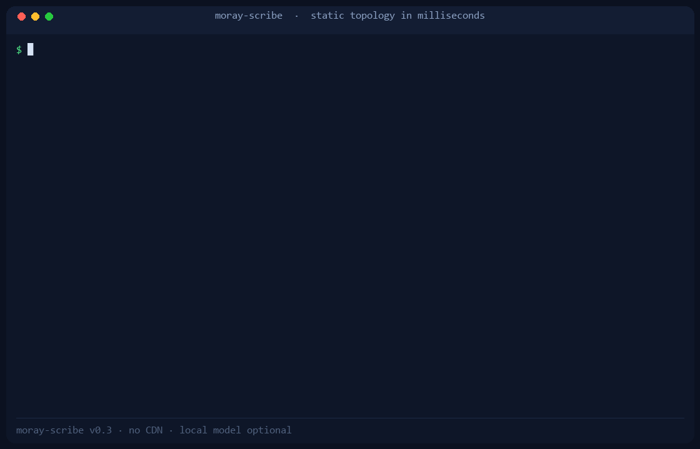
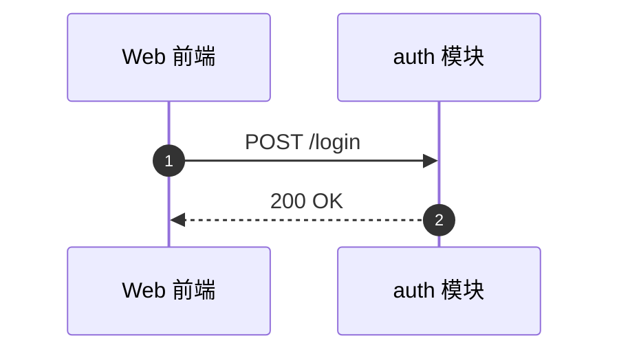
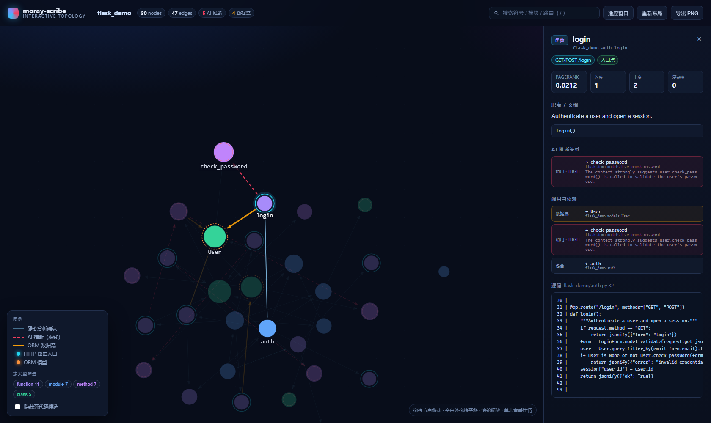
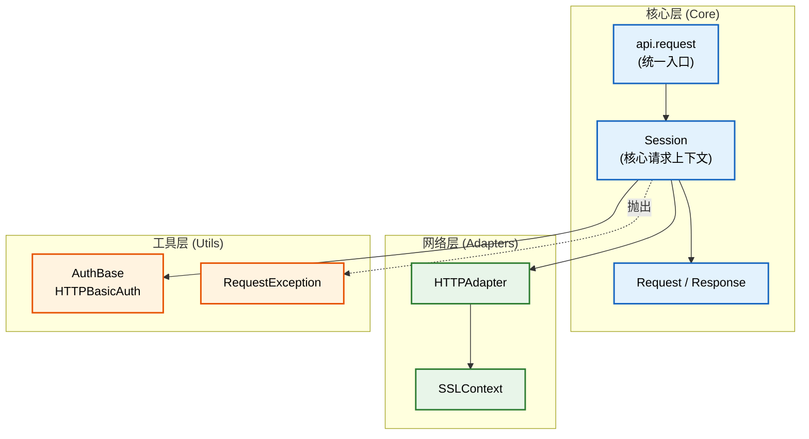

# moray-scribe


> 🏗️ **接手的遗留代码看不懂？让它自己画出架构图。**

几万行的 Python 老项目，没有文档、原作者已离职，市面的 AI 助手只能"打开一个文件问一句"，
你问不到点上，它也讲不清全局。

moray-scribe 用静态分析先把整个项目的符号与调用拓扑提出来，再让**你本机的**大模型做业务
推理，一次性生成分层架构图 + 模块业务说明——**AI 推理和引擎统计严格分区**，可复现、可信任。

它不是"逐文件解释器"：见[真实项目验证报告](docs/realworld-report.md)——在 `psf/requests`
（6394 行）上跑通扫描、建图、枢纽识别与 Mermaid 渲染的完整链路。大规模验证见
[压力测试报告](docs/stress-test-report.md) 与 [终极压测报告](docs/ultimate-benchmark.md)。



*上：`graph` 生成拓扑 → 分阶段性能 → 启动查看器 → 统计 `[AI推断]` 虚线（真实终端输出录制）。*

---

## 🆕 v0.5：开箱即用 · 10 项目实证 · 离线测试生态

### 1. Docker 一条命令，Web UI 直接跑

```bash
docker compose up          # → http://localhost:8000
```

挂载你的项目到 `/work`（compose 默认演示 flask_demo），图谱产物落 `/data` 卷；
**模型不出本机**——容器里的 Graph RAG 问答经 `host.docker.internal` 连宿主机
Ollama。`python:3.12-slim` 314MB，非 root 用户，pip 源可切换。

### 2. 没装 Python？一键安装

```powershell
# Windows
powershell -ExecutionPolicy Bypass -File install.ps1
```
```bash
# Linux / macOS
bash install.sh
# 国内： MORAY_PIP_INDEX=https://pypi.tuna.tsinghua.edu.cn/simple bash install.sh
```

自动找 Python≥3.10（找不到给明确指引）、建独立 venv、优先本地 `dist/` wheel、
检查 Ollama——不碰系统环境。

### 3. 10 个顶级项目的实测榜单

[docs/benchmark-leaderboard.md](docs/benchmark-leaderboard.md) —— tqdm / flask /
requests / pandas / scrapy / click / rich / pydantic / fastapi / aiohttp，
graph+doc 全链路计时、节点/枢纽/死代码/时序图统计。**每个数字都是机器写出的**
（`benchmarks/run_leaderboard.py` → JSONL → `render_leaderboard.py` 渲染），
复现只需三条命令。

### 4. 离线测试生态（CI 友好）

`benchmarks/capture_recordings.py` 把**真实模型输出**录制为回放资产；
`mock_ollama` fixture 在本地起一个 Ollama 线协议回放服务器；
**autouse 离线守卫**让任何试图连接真实 Ollama 端口的测试当场报错——
没有 Ollama 的机器照样 100% 测试全绿。

### 5. 多语言可行性（tree-sitter 实证）

`benchmarks/test_tree_sitter.py`：TypeScript 与 Go 样例经 tree-sitter 解析后
**零改动映射进现有 SymbolGraph 契约**（0 悬挂边）。改造评估见
[docs/multi-lang-future.md](docs/multi-lang-future.md)——schema/描述/渲染/
Viewer/RAG 全层语言无关，工作量集中在调用边解析与框架特化。

## 🆕 v0.4：业务时序图 · Graph RAG 问答 · CI 架构体检

### 1. 从"模块在哪"到"流程怎么走"：核心业务时序图

```bash
moray-scribe doc ./your-legacy-project/ --out ./arch-doc/
# ARCHITECTURE.md 新增「九、核心业务时序图」
```

引擎先从入口点（HTTP 路由 / `main` / CLI / `__init__`）沿 `calls`/`instantiates`
边做**确定性调用链追踪**（PageRank 优先、环剪枝、深度预算），再把链路交给本地
模型生成业务命名的 Mermaid `sequenceDiagram`：



- AI 推理与引擎统计照旧分区：模型校验失败自动**确定性降级**（引擎直绘调用链时序，
  章节挂【引擎统计】标签），文档永远不缺时序图；
- `doc` 同时导出 `sequence-NN.mmd`，可贴进 issue 或 IDE Mermaid 插件。

### 2. 图谱 RAG 问答：Web UI 能看，也能问

```bash
python web_viewer/serve.py out/pruned-graph.json   # 点右下角 💬 问答（快捷键 C）
```

> "如果我要修改用户登录逻辑，会影响到哪些模块？"

后端不把全量代码丢给模型：**先用图算法检索**——词法打分选种子 → **反向 BFS**
找所有调用方（影响面）→ PageRank 决定子图预算 → 源码切片防穿越——再把
"问题 + 检索子图 + 切片"交给 Ollama。回答中的节点芯片**点击直接在画布上高亮**。
仍零依赖：检索与 Ollama 调用全部用标准库实现。

### 3. 一劳永逸：GitHub Action 架构体检

```bash
# 本地就能跑的 CI 门禁
moray-scribe check . --baseline before/pruned-graph.json --fail-on dead
```

把 [`.github/workflows/arch-check.yml`](.github/workflows/arch-check.yml) 拷进
你的仓库：每次 PR 自动在 merge-base 与 PR head 各跑一遍 `graph`，
**新增死代码 → 红灯 + 自动 PR 评论**；top-10 PageRank 枢纽出局/腰斩/新进榜
→ ⚠️ 报警表。无 Secret、权限最小化。详见
[docs/github_action.md](docs/github_action.md)。

---

## 🆕 v0.3：看得见、懂框架、跑得快

### 1. 交互式拓扑：拖拽 / 缩放 / 点击看源码

```bash
moray-scribe graph ./legacy --out out/
python web_viewer/serve.py out/pruned-graph.json    # → http://127.0.0.1:8765/
```



- 灰色实线 = 静态确认；**红色流动虚线 = `[AI推断]`**；橙色粗箭头 = ORM 数据流；
- 点击节点：职责、PageRank、路由徽章、AI 推断理由、调用关系、**源码片段**；
- 零依赖：原生 Canvas + 标准库 HTTP 服务，不联网、不装 npm 包；
- 支持深链：`?select=flask_demo.auth.login` 可把某个符号的视图直接贴进 issue。

### 2. 领域特化：路由表 + 数据流向图

Flask/FastAPI 装饰器、Django `urls.py`（`path()` / `re_path()` / `Class.as_view()`）
都会被解析成确定性路由表；SQLAlchemy/Django ORM 模型被识别为数据库节点，
`Model.query.get()`、`session.commit()`、`user.save()` 等**可静态确认**的调用画出 `data_flow` 边。
`ARCHITECTURE.md` 因此多了两节引擎生成的内容：

```markdown
## 七、API 路由表【引擎统计】
| 方法 | 路径 | 处理函数 | 模块 |
| GET/POST | `/login` | `flask_demo.auth.login` | flask_demo.auth |

## 八、数据流向图【引擎统计】
flowchart TD
    flask_demo_auth_login ==>|"数据流"| flask_demo_models_User
```

不猜：`repo.save()` 这种参数类型未知的调用不会伪造边，而是进入 `--infer` 的推断池。

### 3. 更快更省：冷启动 8.3×、内存 -31%

| 指标（7 文件示例） | v0.2 | v0.3 |
|---|---:|---:|
| 全静态链路 | 1.25 s | **0.15 s** |
| 峰值内存 | 97.4 MB | **67.2 MB** |

移除了 numpy/scipy/networkx 三个重依赖，自研 PageRank 幂迭代（与旧值逐位一致）；
`prune` 不再深拷贝整图。django（**35 万行 / 2,096 文件 / 29,857 节点**）静态链路
峰值 **479 MB**，完整数据与方法见 [docs/ultimate-benchmark.md](docs/ultimate-benchmark.md)。

### 4. 三个顶级项目的架构一览

见 [SHOWCASE.md](SHOWCASE.md)：flask / sqlalchemy / django 的模块级核心架构图
（确定性生成）+ 本地模型的一句话点评 —— **图里没有模型幻觉，模型只写那句话**。

---

## 为什么做这个？

> 市面上的 AI 编程助手（Cursor/Copilot）只能"打开一个文件问一句"，因为大模型上下文装不下
> 几万行代码。一旦让 AI 直接看全项目画架构，它就会**疯狂幻觉**。
>
> 我们的解法：**静态分析提取物理拓扑，大模型只做业务推理**。

---

## 四个必须知道的点

1. **上帝视角，不是文件解释器**：一次扫描建全项目符号图，一次生成全局架构——不是逐文件问答。
2. **AI 不写代码**：大模型只能输出一份经 Pydantic 强校验的 Mermaid 数据 JSON；源码格式由引擎渲染，零幻觉。
3. **本地优先**：Ollama + 你的模型，代码不出本机。7B 模型就能跑。
4. **动态死角也有两条路兜底**（v0.2 新增）：静态启发式 + LLM 动态推断（见下节）。

## 30 秒上手

```bash
pip install moray-scribe
ollama pull qwen2.5:7b
moray-scribe doc ./your-legacy-project/ --out ./arch-doc/ --infer
# → ./arch-doc/ARCHITECTURE.md
```

前置：Python ≥ 3.10、[Ollama](https://ollama.com/)、任意 7B+ coder 模型（推荐 `qwen2.5:7b` / `qwen3.5:9b`）。

## 🆕 v0.2：动态调用死角攻克（Dynamic Inference）

Python 的动态特性是纯静态分析的死穴——`self.engine.run()` 的 `engine` 是什么类型？
`importlib.import_module("pkg.sub")` 加载了谁？v0.2 用**两层防线**补盲区：

**第一层：静态启发式（默认开启，零成本、确定性）**

- 追踪 `self.x = ClassA()` / `setattr(self, "x", ClassA())` 赋值，把 `self.x.method()`
  解析到 `ClassA.method`（工厂函数返回类型未知时保守跳过）；
- `self.method()` 直接解析到本类方法；
- `importlib.import_module("pkg.sub")` / `__import__` / `from importlib import import_module`
  的字面量调用接入模块图。

**第二层：LLM 动态推断（`--infer` 开启，异步批量）**

静态层仍解析不了的**悬空调用**，按 PageRank 排序取前 N 个（`MORAY_SCRIBE_INFERENCE_MAX_CALLS`），
连同调用方源码片段与候选符号清单，经 `asyncio` 并发送本地模型推断，输出 Pydantic 校验的
`InferredEdge`：

- **high 置信度** → 合入主图（`inferred=True` 标记）；
- **medium / low** → 记入「已知缺口」，不合图。

**渲染约定（一眼分清真假）：**

```
A --> B      实线 = 静态分析确认的拓扑，绝对准确
A -.-> B     虚线 = AI 推断补全，图中带 [AI推断] 标签并附图例，可能有误
```

文档新增「八、AI 动态推断」章节：合入边全表（含依据）、中低置信度明细、token 消耗统计。
整条推断链路可被 Mock 全测（`tests/test_inferencer.py`），不依赖网络。

## 它长什么样

`ARCHITECTURE.md` 顶部是一张 Mermaid 分层架构图（模块级，不是类级），往下是每个模块的
业务说明，再往下是**引擎算出来的**核心枢纽 / 死代码 / 已知缺口——AI 说什么、引擎算什么，
一眼分清。`.mmd` 图可直接粘进 [mermaid.live](https://mermaid.live) 渲染。

**能力证明**：见 [真实项目验证报告](docs/realworld-report.md)——用 qwen2.5:7b 在
`psf/requests`（6394 行）上原生生成架构草稿，评测结果、问题清单、改进建议全部公开。

**示例项目**：`examples/flask_demo/` 是一个可运行的 Flask + SQLAlchemy 小应用，
其完整产物（`ARCHITECTURE.md` / `pruned-graph.json` / `.mmd`）已提交在
`docs/assets/flask_demo/`，可直接对照源码阅读。

> `doc` 模式的完整生成依赖本地模型推理速度：7B 模型在千行级项目上通常需 2–10 分钟，
> 更大的项目或较慢的 CPU 建议调大 `MORAY_SCRIBE_REQUEST_TIMEOUT_S`（或 `--timeout`）与
> `MORAY_SCRIBE_MAX_OUTPUT_TOKENS`，或换用更快的模型 / GPU 加速。

## 五种用法

| 用法 | 输入 | 输出 | 需要 LLM |
|---|---|---|---|
| `scan` | 目录 | symbol-graph.json | ❌ |
| `graph` | 目录 | pruned-graph.json（含枢纽/死代码/路由/数据流） | ❌ |
| **`web_viewer`** | pruned-graph.json | 可拖拽的交互拓扑（浏览器） | ❌ |
| `diagram` | 目录 | architecture-draft.json | ✅ |
| `doc` | 目录 | **ARCHITECTURE.md + .mmd + pruned-graph.json** | ✅（`--infer` 再加动态推断） |

```bash
moray-scribe scan ./legacy/ --out symbols.json
moray-scribe graph ./legacy/ --max-nodes 200
moray-scribe doc ./legacy/ --out ./arch-doc/ --infer
python web_viewer/serve.py ./arch-doc/pruned-graph.json
```

下面是用 moray-scribe 分析 `psf/requests`（6394 行）后生成的架构图实景（GitHub 原生渲染，
可直接复制体验）：



*上图：使用 moray-scribe 分析 `psf/requests`（6394 行）后，引擎自动生成的架构图
（由大模型基于符号图推理）。*

## 接入 Cursor（MCP）

三步挂进 Cursor / Claude Desktop：

1. **装**：`pip install -e .`（或 `pip install moray-scribe`），确认 `moray-scribe serve-mcp --help` 正常。
2. **配**：在 `.cursor/mcp.json`（或 Claude Desktop 配置）加入：
   ```json
   { "mcpServers": { "moray-scribe": {
       "command": "moray-scribe", "args": ["serve-mcp"],
       "env": { "MORAY_SCRIBE_MODEL_DESCRIBER": "qwen2.5:7b" } } } }
   ```
3. **用**：对话里让模型调用工具，它会自行选择：

| 工具 | 用途 |
|---|---|
| `scribe_health` | 检查 Ollama / 模型 / 输出目录是否就绪 |
| `scribe_scan` | 扫描符号清单（不调 LLM），返回摘要 |
| `scribe_graph` | 建图 + PageRank + 死代码，返回摘要 |
| `scribe_doc` | 生成 ARCHITECTURE.md + .mmd，返回路径与摘要 |
| `scribe_read_artifact` | 按章节/大小分块读回产物（保护上下文） |
| `scribe_list_symbols` | 分页查询符号图 |

<details>
<summary>👉 点击展开：AI 推理与引擎统计的分区哲学</summary>

- **物理分析精确 + 语义推理补缺**：拓扑边宁缺毋滥，缺口显式标注，不让模型瞎编。
- **AI / 引擎分区**：模型推断的和引擎计算的在文档里分区呈现，读者知道该信哪部分。
- **可复现**：同一输入两次运行，`ARCHITECTURE.md` 与 `.mmd` 字节一致（无时间戳、无随机）。

</details>

## 已知限制（v0.4.0）

- **时序图链路**：调用链追踪只沿 `calls`/`instantiates` 静态边（含已合并的
  `[AI推断]` 边）；纯动态分发（反射、字符串路由）不在链上，会留在「已知缺口」。
  模型命名的流程标题/摘要有可能不准确（引擎只保证调用顺序为真）。
- **Graph RAG 问答**：检索是词法 + 图结构（CJK 按二元组匹配），没有向量库；
  提问里最好带上符号名 / 路由 / 模块名等英文关键词。Ollama 离线时 chat 返回
  502，查看器其余功能不受影响。
- **架构体检**：`check` 假设两份图谱用相同的 `--max-nodes` / `--exclude` 生成
  （工作流已固定）；死代码是候选而非判决，删除前请人工确认。

0. **首次跑 doc 需要硬件准备**——7B 模型在纯 CPU 上生成 architecture draft 需要
   2-10 分钟（取决于项目规模与 CPU）。若你的机器被其他任务占用（IDE / 浏览器 / 其他
   模型服务），耗时会显著拉长。**建议**：doc 阶段前关闭其他 Ollama 请求，或设
   `MORAY_SCRIBE_REQUEST_TIMEOUT_S=900`（或 `--timeout 900`）。
   **排查提示**：若机器有独立 GPU 但 doc 阶段明显慢，先运行 `ollama ps`
   确认 Ollama 是否在用 GPU（`PROCESSOR` 列应为 `100% GPU` 或混合）。若显示
   `100% CPU`，参考 [Ollama GPU 配置](https://github.com/ollama/ollama/blob/main/docs/gpu.md)
   调整。
- 仅支持 Python（基于 libcst）
- 路由识别覆盖 Flask/FastAPI 装饰器与 Django `urls.py` 的常见写法；自定义注册
  （如自研装饰器、运行时 `add_url_rule` 循环）不识别，会留在已知缺口
- 数据流只画**静态可确认**的 ORM 调用；参数类型未知的 `repo.save()` 不猜，交给 `--infer`
- Web UI 是只读查看器（不能改代码），单页建议 ≤ 2,000 节点以保证拖拽流畅
- 动态调用两层防线仍有边界：`getattr(x, name)` 反射调用、跨文件 monkey-patch、
  字符串拼接的动态 import 不解析，会留在「已知缺口」；LLM 推断只覆盖有候选目标的调用
- 多继承 `super()` 歧义跳过（不猜）
- 大项目（> 5000 符号）需调小 `max_nodes`、调大 `MAX_OUTPUT_TOKENS`
- 首图强制 flowchart（架构图）；`classDiagram` 仅作可选细节图

详见 [CHANGELOG](CHANGELOG.md) 的完整限制列表。

## 文档

- [真实项目验证报告](docs/realworld-report.md)
- [压力测试报告](docs/stress-test-report.md)（django / sqlalchemy / flask 全链路实测）
- [架构设计说明](docs/architecture.md)
- [CHANGELOG](CHANGELOG.md)

## 🗺️ Roadmap

- [x] v0.1.0: 四模式管线、MCP 接入、核心防幻觉闭环
- [x] v0.2.0: 动态调用死角攻克（静态启发式 + LLM 悬空调用推断）、大规模压力测试
- [x] v0.3.0: 交互式拓扑、领域特化（路由/数据流）、零依赖 PageRank、极限压测
- [x] v0.4.0: 业务时序图、Graph RAG 问答、GitHub Action 架构体检
- [ ] v0.2.1: 补充真实自我剖析 `examples`，接首批 Issue
- [ ] v0.5.0: 支持 JS/TS (tree-sitter)

## License

[MIT](LICENSE)
