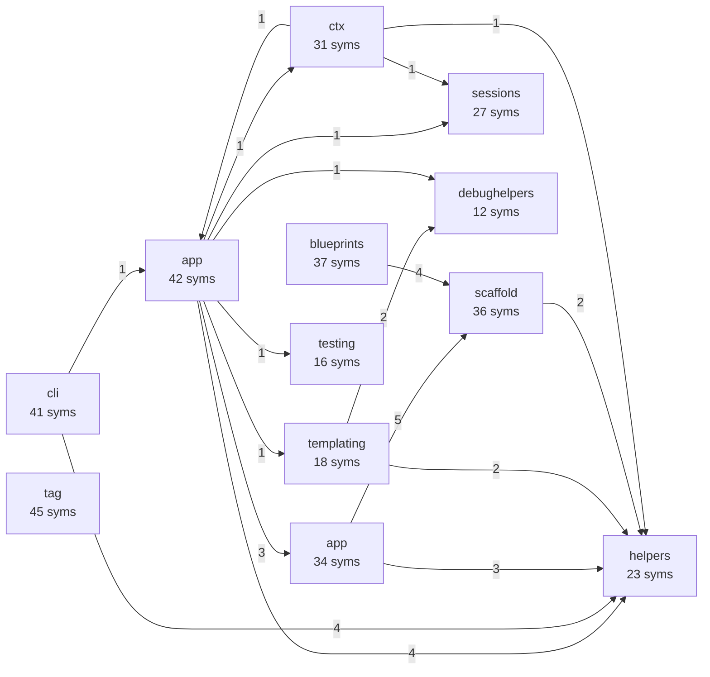
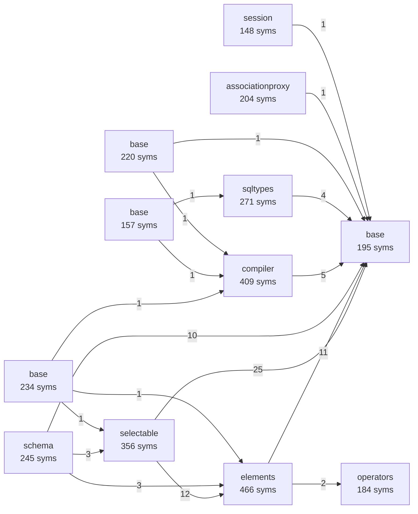
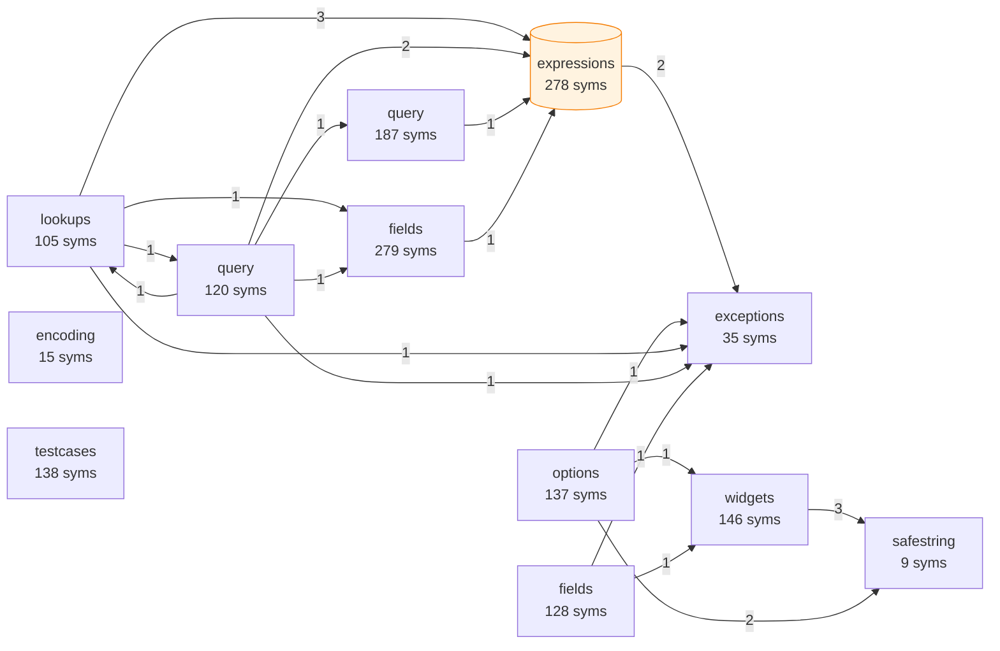

# moray-scribe SHOWCASE

> 由 moray-scribe v0.3.0 自动生成 · 图谱为**确定性静态分析**产物，
> 仅每节末尾的一句点评由本地大模型撰写。

三个顶级开源项目的逆向架构视图：每个项目只扫描、建图、聚合模块，
**不让模型参与画图**——图里的每条边都能回溯到源码。

| 项目 | 领域 | Python 文件 | 符号 | 图节点/边 | 路由 | ORM 模型 | 数据流 |
|---|---|---:|---:|---|---:|---:|---:|
| [pallets/flask](#flask) | Web 框架 | 24 | 416 | 440/685 | 0 | 0 | 0 |
| [sqlalchemy/sqlalchemy](#sqlalchemy) | ORM / 数据库工具包 | 218 | 11,153 | 11,371/18,129 | 0 | 0 | 1 |
| [django/django](#django) | 全栈 Web 框架 | 920 | 11,656 | 12,576/23,513 | 19 | 82 | 23 |

<a id="flask"></a>

## pallets/flask

**规模**：24 个 Python 文件 · 416 个符号 · 24 个模块 · 230 个死代码候选

**模块级核心架构**（按 PageRank 取前 12 个模块；箭头上的数字是聚合后的
导入/调用/继承关系数；虚线框圆角节点 = 含 ORM 模型的模块）：



**引擎观测**

- 核心枢纽：`flask.app.Flask.ensure_sync`, `flask.app.Flask.async_to_sync`, `flask.sansio.blueprints.Blueprint.record_once`
- 静态路由：0 条 · ORM 模型类：0 个 · 确认数据流：0 条

> 💬 **AI 点评**：app 作为入口层，依赖 cli 和 blueprints

---

<a id="sqlalchemy"></a>

## sqlalchemy/sqlalchemy

**规模**：218 个 Python 文件 · 11,153 个符号 · 218 个模块 · 5,330 个死代码候选

**模块级核心架构**（按 PageRank 取前 12 个模块；箭头上的数字是聚合后的
导入/调用/继承关系数；虚线框圆角节点 = 含 ORM 模型的模块）：



**引擎观测**

- 核心枢纽：`sqlalchemy.util.concurrency.greenlet_spawn`, `sqlalchemy.util.concurrency.await_`, `sqlalchemy.util.concurrency._safe_cancel_awaitable`
- 静态路由：0 条 · ORM 模型类：0 个 · 确认数据流：1 条

> 💬 **AI 点评**：compiler 是中枢，处理语法编译。

---

<a id="django"></a>

## django/django

**规模**：920 个 Python 文件 · 11,656 个符号 · 920 个模块 · 5,750 个死代码候选

**模块级核心架构**（按 PageRank 取前 12 个模块；箭头上的数字是聚合后的
导入/调用/继承关系数；虚线框圆角节点 = 含 ORM 模型的模块）：



**引擎观测**

- 核心枢纽：`django.core.exceptions.ImproperlyConfigured`, `django.core.exceptions.ValidationError`, `django.utils.module_loading.import_string`
- 静态路由：19 条 · ORM 模型类：82 个 · 确认数据流：23 条

> 💬 **AI 点评**：expressions 是表达式层，支持 ORM 查询

---

## 复现方式

```bash
# 1) 只做确定性拓扑（无需模型，秒级）
moray-scribe graph path/to/project --out out/

# 2) 交互式查看同一张图
python web_viewer/serve.py out/pruned-graph.json

# 3) 重新生成本文件（需要 .stress/ 下的三个克隆）
python benchmarks/showcase.py --projects flask,sqlalchemy,django
```

*生成工具：moray-scribe v0.3.0 · 数据源：本地浅克隆的官方仓库*
