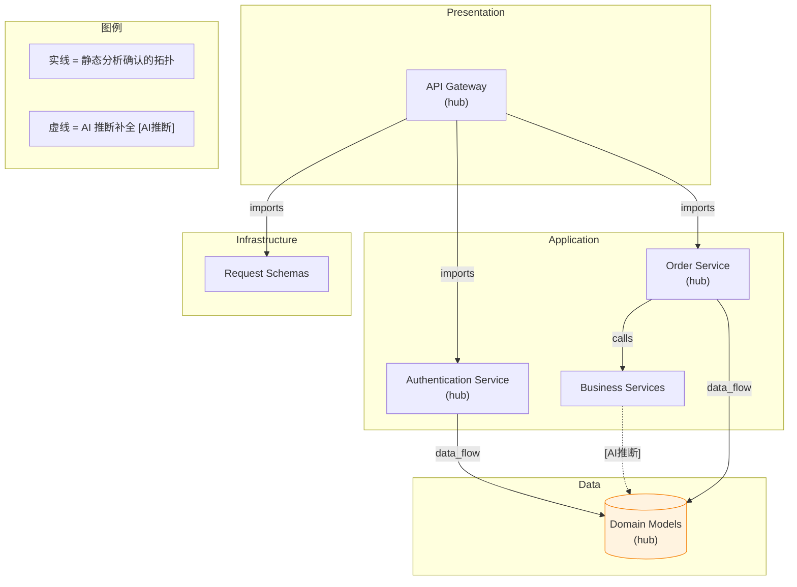
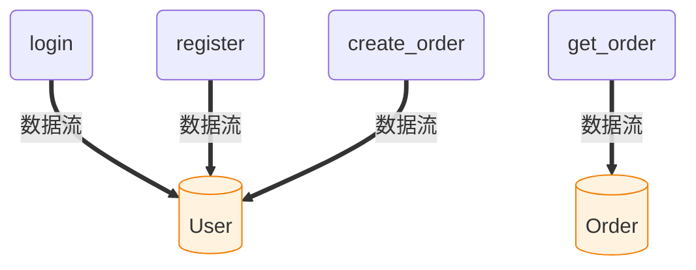
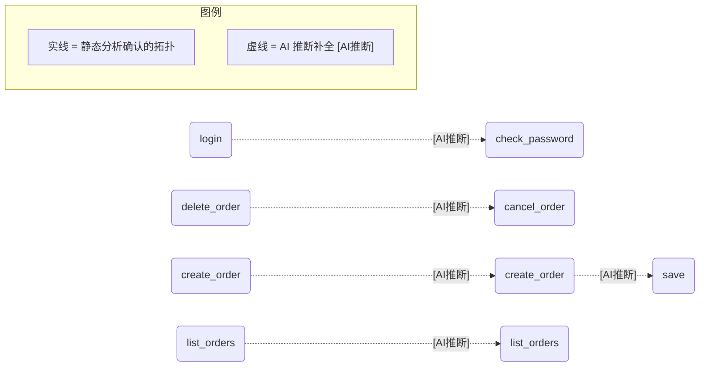

# flask_demo · 架构文档

> 本文件由 moray-scribe 生成。**AI 推理**与**引擎统计**两部分显式分栏，
> 前者由大模型基于符号图推理，可能有推断误差；后者由静态分析确定性计算，可复现。

---

## 一、概览【AI 推理】

A Flask web application with authentication, order management, and data persistence layers. The architecture separates concerns between API endpoints, business services, domain models, and request schemas.

**风险点：**
- Function flask_demo.__main__.create_app.attach_session has no recorded calls; may use dynamic dispatch.
- Function flask_demo.auth.hash_password has no recorded calls; may use dynamic dispatch.
- Function flask_demo.auth.logout has no recorded calls; may use dynamic dispatch.
- Method flask_demo.models.User.check_password has no recorded calls; may use dynamic dispatch.
- Method flask_demo.models.Order.mark_paid has no recorded calls; may use dynamic dispatch.
- Method flask_demo.models.Order.save has no recorded calls; may use dynamic dispatch.
- 2 classes inherit from external base Base class; external documentation needed.
- 2 schemas inherit from external BaseModel class; external documentation needed.

**建议：**
- Document the external Base and BaseModel base classes to understand inheritance contracts.
- Add explicit call tracking for functions with missing recorded calls in static analysis.
- Consider consolidating hash_password into auth_service module for better cohesion.
- Add session management documentation for attach_session dynamic dispatch behavior.

---

## 二、系统架构图【AI 推理】

### 主图（architecture）

### 细节图（可选）

_（本次未生成细节图）_

---

## 三、模块详解【AI 推理】

### `flask_demo.__main__`

- **职责**：Create Flask application instance；Register API routes；Health check endpoint
- **关键符号**：`flask_demo.__main__`, `flask_demo.__main__.create_app`
- **风险**：low

### `flask_demo.auth`

- **职责**：User registration endpoint；Login authentication；Session management；Password hashing
- **关键符号**：`flask_demo.auth.register`, `flask_demo.auth.login`
- **风险**：medium

### `flask_demo.orders`

- **职责**：List user orders；Create new orders；Get order by ID；Delete/cancel orders
- **关键符号**：`flask_demo.orders.list_orders`, `flask_demo.orders.create_order`
- **风险**：low

### `flask_demo.models`

- **职责**：Define User entity；Define Order entity；Database persistence
- **关键符号**：`flask_demo.models.User`, `flask_demo.models.Order`
- **风险**：low

### `flask_demo.services`

- **职责**：Order business logic；Data access layer；Service orchestration
- **关键符号**：`flask_demo.services.OrderService`
- **风险**：low

### `flask_demo.schemas`

- **职责**：Define request schemas；Define response schemas；Data validation
- **关键符号**：`flask_demo.schemas`
- **风险**：low

---

## 四、核心枢纽【引擎统计】

按 PageRank 排序，这些节点是全项目拓扑意义上的"关键枢纽"：

| 排名 | 符号 | 类型 | 模块 | PageRank |
|---:|---|---|---|---:|
| 1 | `flask_demo.models.User.check_password` | method | flask_demo.models | 0.0814 |
| 2 | `flask_demo.services.OrderService` | class | flask_demo.services | 0.0767 |
| 3 | `flask_demo.models.User` | class | flask_demo.models | 0.0747 |
| 4 | `flask_demo.models.Order` | class | flask_demo.models | 0.0653 |
| 5 | `flask_demo.models.Order.mark_paid` | method | flask_demo.models | 0.0457 |
| 6 | `flask_demo.models.Order.save` | method | flask_demo.models | 0.0457 |
| 7 | `flask_demo.models` | module | flask_demo.models | 0.0357 |
| 8 | `flask_demo.services.OrderService.__init__` | method | flask_demo.services | 0.0342 |
| 9 | `flask_demo.services.OrderService.cancel_order` | method | flask_demo.services | 0.0342 |
| 10 | `flask_demo.services.OrderService.create_order` | method | flask_demo.services | 0.0342 |
| 11 | `flask_demo.services.OrderService.list_orders` | method | flask_demo.services | 0.0342 |
| 12 | `flask_demo.auth.hash_password` | function | flask_demo.auth | 0.0302 |
| 13 | `flask_demo.schemas.LoginForm` | class | flask_demo.schemas | 0.0281 |
| 14 | `flask_demo.schemas.OrderForm` | class | flask_demo.schemas | 0.0281 |
| 15 | `flask_demo.__main__.create_app.attach_session` | function | flask_demo.__main__ | 0.0277 |
| 16 | `flask_demo.__main__.create_app.health` | function | flask_demo.__main__ | 0.0277 |
| 17 | `flask_demo.schemas` | module | flask_demo.schemas | 0.0240 |
| 18 | `flask_demo.__main__.create_app` | function | flask_demo.__main__ | 0.0230 |
| 19 | `flask_demo.auth` | module | flask_demo.auth | 0.0230 |
| 20 | `flask_demo.orders` | module | flask_demo.orders | 0.0230 |

---

## 五、死代码候选【引擎统计】

> ⚠️ 以下符号入度为 0、非入口、非私有工具。
> 建议人工确认后**删除或标注**——不要盲目信任本列表。

- `flask_demo.__main__.create_app.attach_session`（function, flask_demo.__main__）
- `flask_demo.models.Order.mark_paid`（method, flask_demo.models）
- `flask_demo.schemas.LoginForm`（class, flask_demo.schemas）
- `flask_demo.schemas.OrderForm`（class, flask_demo.schemas）

---

## 六、入口点【引擎统计】

- `flask_demo.__main__`（module, flask_demo.__main__）
- `flask_demo.__main__.create_app.health`（function, flask_demo.__main__）
- `flask_demo.auth.register`（function, flask_demo.auth）
- `flask_demo.auth.login`（function, flask_demo.auth）
- `flask_demo.auth.logout`（function, flask_demo.auth）
- `flask_demo.orders.list_orders`（function, flask_demo.orders）
- `flask_demo.orders.create_order`（function, flask_demo.orders）
- `flask_demo.orders.get_order`（function, flask_demo.orders）
- `flask_demo.orders.delete_order`（function, flask_demo.orders）
- `flask_demo.services.OrderService.__init__`（method, flask_demo.services）

---

## 七、API 路由表【引擎统计】

扫描器从路由装饰器（Flask/FastAPI/Django 风格）中确定性提取，非 AI 推断：

| 方法 | 路径 | 处理函数 | 模块 |
|---|---|---|---|
| GET | `/health` | `flask_demo.__main__.create_app.health` | flask_demo.__main__ |
| GET/POST | `/login` | `flask_demo.auth.login` | flask_demo.auth |
| POST | `/logout` | `flask_demo.auth.logout` | flask_demo.auth |
| POST | `/orders` | `flask_demo.orders.create_order` | flask_demo.orders |
| GET | `/orders` | `flask_demo.orders.list_orders` | flask_demo.orders |
| DELETE | `/orders/<int:order_id>` | `flask_demo.orders.delete_order` | flask_demo.orders |
| GET | `/orders/<int:order_id>` | `flask_demo.orders.get_order` | flask_demo.orders |
| POST | `/register` | `flask_demo.auth.register` | flask_demo.auth |

---

## 八、数据流向图【引擎统计】

> 粗箭头（`==>`）= 静态分析确认的数据流向（ORM 查询/会话提交/模型写入）。
> 橙色数据库节点 = 识别出的 ORM 模型类。此图为确定性生成，非 AI 推断。

涉及的数据流明细：

| 调用方 | 数据目标 | 类型 |
|---|---|---|
| `flask_demo.auth.login` | `flask_demo.models.User` | ORM 模型 |
| `flask_demo.auth.register` | `flask_demo.models.User` | ORM 模型 |
| `flask_demo.orders.get_order` | `flask_demo.models.Order` | ORM 模型 |
| `flask_demo.services.OrderService.create_order` | `flask_demo.models.User` | ORM 模型 |

---

## 九、已知缺口【引擎统计 + AI 提示】

> 以下关系 scanner 无法百分百确认，AI 推理中也未覆盖。
> 人工审查时请重点确认这些位置。

- Function flask_demo.__main__.create_app.attach_session has no recorded calls; may use dynamic dispatch.
- Function flask_demo.__main__.create_app.health has no recorded calls; may use dynamic dispatch.
- Function flask_demo.auth.hash_password has no recorded calls; may use dynamic dispatch.
- Function flask_demo.auth.logout has no recorded calls; may use dynamic dispatch.
- Method flask_demo.models.User.check_password has no recorded calls; may use dynamic dispatch.
- Method flask_demo.models.Order.mark_paid has no recorded calls; may use dynamic dispatch.
- Method flask_demo.models.Order.save has no recorded calls; may use dynamic dispatch.
- Method flask_demo.services.OrderService.__init__ has no recorded calls; may use dynamic dispatch.
- Method flask_demo.services.OrderService.list_orders has no recorded calls; may use dynamic dispatch.
- Method flask_demo.services.OrderService.cancel_order has no recorded calls; may use dynamic dispatch.
- 2 classes inherit from external base `Base` (e.g. `flask_demo.models.User`, `flask_demo.models.Order`); external base docs may be needed.
- 2 classes inherit from external base `BaseModel` (e.g. `flask_demo.schemas.LoginForm`, `flask_demo.schemas.OrderForm`); external base docs may be needed.

---

## 十、AI 动态推断【AI 推断】

> **实线是静态分析确认的拓扑，虚线（`-.->`）是 AI 推断补全。**
> 推断边来自大模型对悬空调用的分析，已合并的均标注 `[AI推断]`，
> 可能有误，请人工复核后再采信。

以下 **5** 条高置信度推断边已合并进符号图，并在架构图中以虚线渲染：

| 调用方 | 被调方（推断） | 原始调用 | 依据 |
|---|---|---|---|
| `flask_demo.auth.login` | `flask_demo.models.User.check_password` | `user.check_password` | The context strongly suggests user.check_password() is called to validate the user's password. |
| `flask_demo.orders.create_order` | `flask_demo.services.OrderService.create_order` | `service.create_order` | The context shows service.create_order() is called with the provided arguments. |
| `flask_demo.orders.delete_order` | `flask_demo.services.OrderService.cancel_order` | `OrderService.cancel_order` | The context shows cancel_order() is called with the provided order_id. |
| `flask_demo.orders.list_orders` | `flask_demo.services.OrderService.list_orders` | `service.list_orders` | The context shows list_orders() is called to list orders for the current user. |
| `flask_demo.services.OrderService.create_order` | `flask_demo.models.Order.save` | `order.save` | The context shows order.save() is called after order is created. |

**AI 推断补全的调用关系** —— 红色虚线 = 大模型对悬空调用的补全，需人工复核：

推断统计：候选 60，送入模型 5，请求 1 次，token 消耗约 1263(入) + 258(出)，无效回答 0。

---

## 附录：项目统计【引擎统计】

| 指标 | 数值 |
|---|---|
| 分析文件数 | 7 |
| 符号总数 | 23 |
| 模块数 | 7 |
| 边总数 | 47 |
| 图密度 | 0.0540 |

*生成工具：moray-scribe v0.3.0*