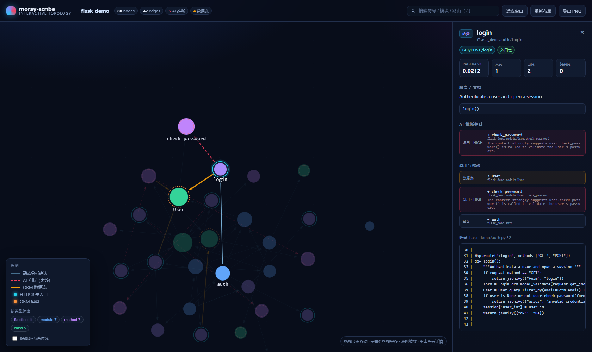

# moray-scribe Web Viewer

零依赖的交互式符号拓扑浏览器 + **图谱 RAG 问答**。不联网、不装 npm 包、
不依赖 CDN——只用 HTML + 原生 JavaScript + Canvas 2D + Python 标准库。



## 启动

```bash
# 先用 CLI 生成图谱（确定性静态分析，秒级）
moray-scribe graph path/to/project --out out/

# 再起查看器
python web_viewer/serve.py out/pruned-graph.json
# → http://127.0.0.1:8765/
```

`serve.py` 只依赖 Python 标准库。图谱 JSON 里带有 `metadata.root`（扫描根目录），
所以侧边栏的源码片段默认就能打开；需要覆盖时传 `--source-root`：

```bash
python web_viewer/serve.py out/pruned-graph.json \
    --source-root path/to/project --port 9000 --project "My Legacy App"
```

## 交互

| 操作 | 效果 |
|---|---|
| 拖拽节点 | 移动节点（力导向布局会重新收敛） |
| 拖拽空白 | 平移画布 |
| 滚轮 | 以光标为中心缩放 |
| 单击节点 | 侧边栏：职责/文档、PageRank、度数、复杂度、路由、源码 |
| 双击节点 | 把该节点居中 |
| 搜索框 | 按符号 / 模块 / 路由过滤（`/` 聚焦，回车跳到首个命中） |
| `C` / 💬 按钮 | 打开图谱问答（Graph RAG Chat，需本机 Ollama） |
| `F` / `R` | 适应窗口 / 重新布局 |
| `Esc` | 关闭问答面板 / 取消选择 |
| 图例底部 | 按类型筛选、隐藏死代码候选 |
| 导出 PNG | 把当前视图存成图片 |

## 图谱问答（Graph RAG Chat，v0.4）

右下角 💬 打开对话框，用自然语言向**符号图**提问，例如
「修改 login 逻辑会影响哪些模块？」。流程：

1. 检索：词法打分（符号名 / id / 模块 / 路由 / 文档）选种子 →
   **反向 BFS** 找所有调用方（影响面）→ 单跳正向扩展 → PageRank 决定
   子图预算（默认 ≤ 24 节点）→ 最多 4 片源码切片（防目录穿越）；
2. 问答：检索子图 + 切片 + 问题 → 本机 Ollama（JSON 回答 + 引用节点）；
3. 高亮：回答中的**节点芯片点击直接画布选中+居中**；未引用具体节点时
   展示检索到的相关节点。

启动参数：

```bash
python web_viewer/serve.py out/pruned-graph.json \
    --ollama-host http://127.0.0.1:11434 --chat-model qwen2.5:7b
python web_viewer/serve.py out/pruned-graph.json --no-chat   # 关闭问答
```

Ollama 离线时问答返回 502（气泡内提示），其余功能不受影响。

## 视觉语义

| 视觉 | 含义 |
|---|---|
| 灰色实线箭头 | 静态分析确认的调用/导入/继承 |
| **红色虚线（流动）箭头** | `[AI推断]` 动态推断补全的关系 |
| 橙色粗箭头 | 确认的 ORM 数据流（`data_flow`） |
| 青色外环 | HTTP 路由处理函数（Flask/FastAPI/Django） |
| 橙色虚线外环 | ORM 模型类 |
| 红色内环 | 死代码候选 |
| 节点大小 | PageRank 与度数 |

## 可分享的深链

页面状态可以通过 URL 参数复现，便于贴到 issue / PR 里：

```
http://127.0.0.1:8765/?select=flask_demo.auth.login&settle=400
```

| 参数 | 作用 |
|---|---|
| `select=<symbol id>` | 选中节点（支持唯一后缀匹配） |
| `settle=<N>` | 首帧前同步跑 N 步布局（截图可复现） |
| `hide_dead=1` | 初始隐藏死代码候选 |
| `q=<text>` | 预填搜索框 |
| `debug=1` | 显示运行时状态面板（headless 诊断用） |

## API

查看器背后的只读接口 + 问答接口，方便二次集成：

- `GET /api/config` → 项目名、扫描根、节点数、chat 是否启用
- `GET /api/graph` → 原始图谱 JSON
- `GET /api/source?file=&start=&end=` → 源码片段（限制在扫描根内，防目录穿越）
- `POST /api/chat` → `{"question": "..."}` → `{"answer", "nodes", "degraded",
  "context": {nodes, edges, slices}, "context_nodes"}`（Graph RAG：反向 BFS
  子图检索 + PageRank 预算 + 源码切片；Ollama 不可用时 502）

## 数据来源

`moray-scribe graph` 写出 `pruned-graph.json`；`moray-scribe doc` 也会把同一份
图谱写在 `ARCHITECTURE.md` 旁边，两者都可以直接喂给查看器。
